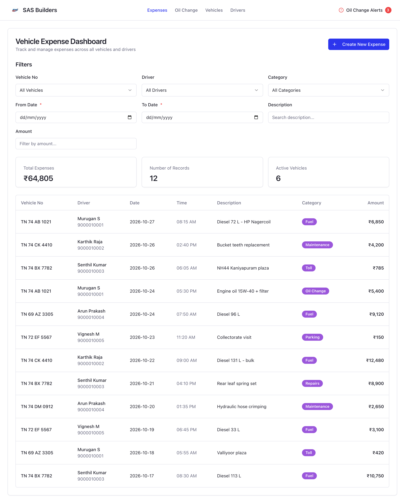
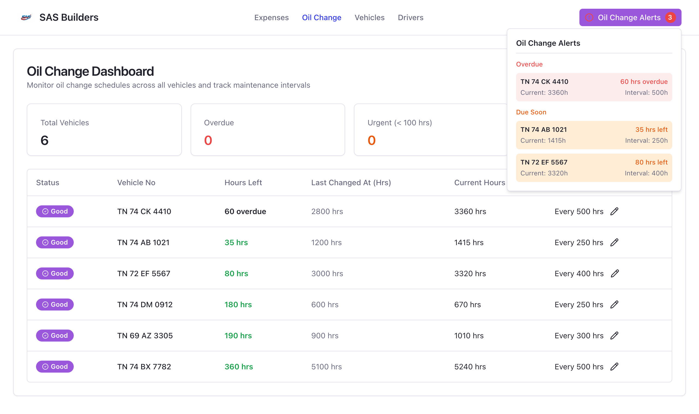
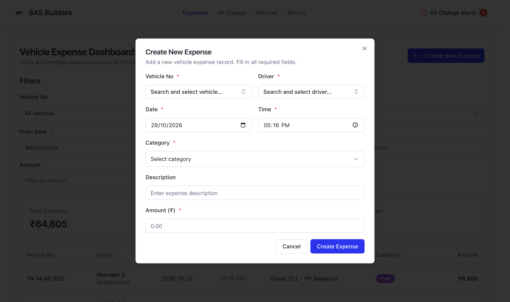
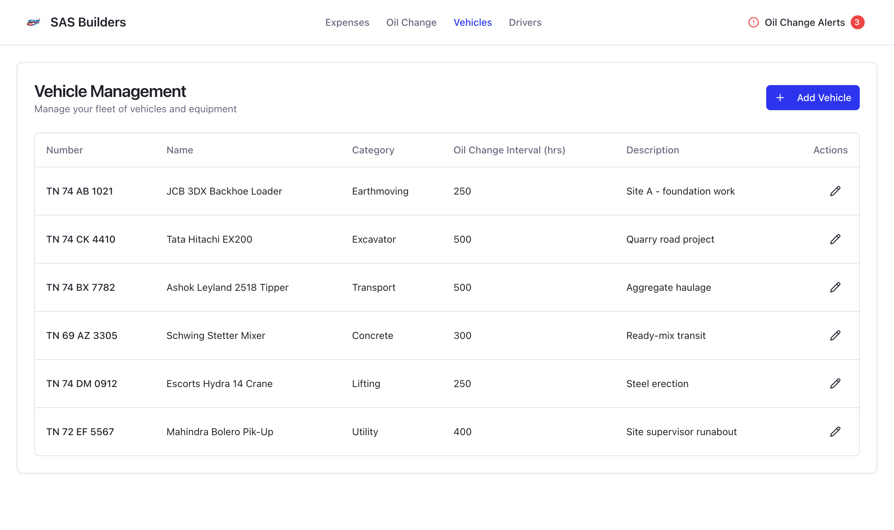
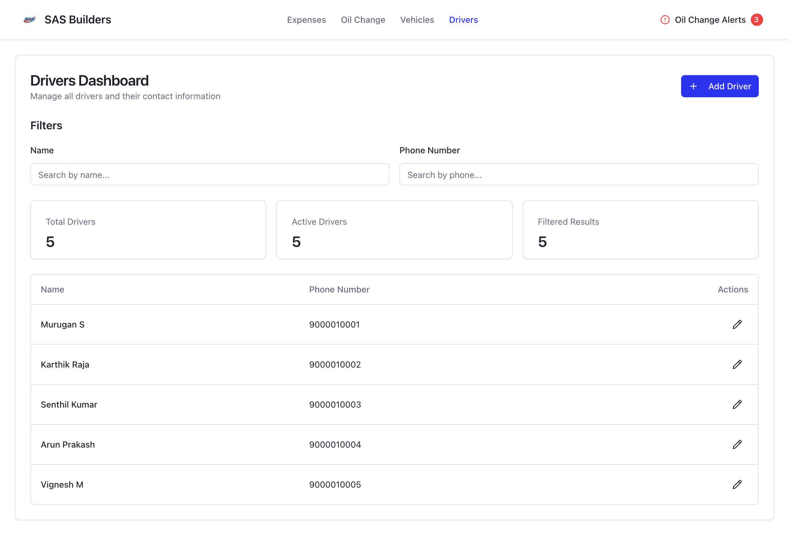
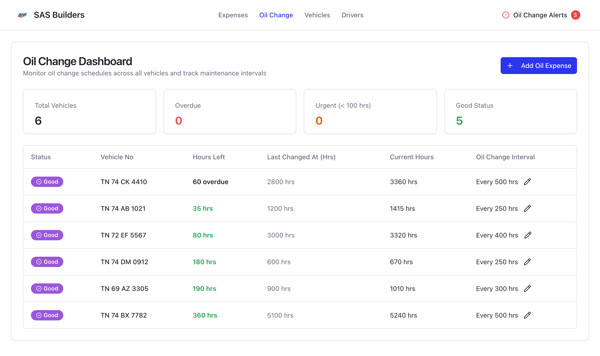

<div align="center">


# SAS Builders

**A fleet and expense management dashboard for construction businesses.**

Track every vehicle and machine, log driver expenses, and stay ahead of oil changes based on actual engine hours.

[](LICENSE)
[](https://nextjs.org/)
[](https://react.dev/)
[](https://vercel.com/joys-projects-c1d58619/v0-new-components-shadcn-ui-ko)
[](https://v0.app/chat/uWmizQIQsLh)

</div>



---

## Table of contents

- [Features](#features)
- [Screenshots](#screenshots)
- [Tech stack](#tech-stack)
- [Getting started](#getting-started)
- [Configuration](#configuration)
- [Project structure](#project-structure)
- [Available scripts](#available-scripts)
- [Deployment](#deployment)
- [Related repositories](#related-repositories)
- [License](#license)

## Features

| Module | What it does |
| --- | --- |
| **Expenses** | Log fuel, maintenance, tolls, parking, repairs and oil changes per vehicle and driver. Filter by vehicle, driver, category, date range, description or amount, with live totals. |
| **Oil Change** | Engine-hour based service tracking: hours left, last change, current hours and per-vehicle intervals. Add an oil expense to reset the cycle, or edit the interval inline. |
| **Oil Change Alerts** | A navbar alert lists vehicles that are **overdue** or **due within 100 hours**, on every page. |
| **Vehicles** | Manage the fleet: registration number, name, category, oil change interval and notes. |
| **Drivers** | Keep a searchable list of drivers and their phone numbers. |

## Screenshots

> The screenshots use fictional demo data.

### Oil change alerts

Overdue and due-soon vehicles at a glance.



<br />

### Create expense

Searchable vehicle and driver pickers.



<br />

### Vehicles

Fleet and equipment register.



<br />

### Drivers

Driver contacts with search filters.



<br />

### Oil change dashboard



## Tech stack

- **Framework:** [Next.js 15](https://nextjs.org/) (App Router) and [React 19](https://react.dev/)
- **Language:** TypeScript
- **UI:** [shadcn/ui](https://ui.shadcn.com/) on [Radix UI](https://www.radix-ui.com/), [Tailwind CSS](https://tailwindcss.com/), [Lucide](https://lucide.dev/) icons
- **State:** [Redux Toolkit](https://redux-toolkit.js.org/) for expense, driver and oil-change state
- **Forms and validation:** React Hook Form and Zod
- **HTTP:** Axios (`lib/axios.ts`)
- **Analytics:** Vercel Analytics

## Getting started

### Prerequisites

- [Node.js](https://nodejs.org/) 20 or newer
- A running instance of the [SAS Builders Backend](https://github.com/JOY-SAM/SAS_Builders_Backend) API

### 1. Clone and install

```bash
git clone https://github.com/JOY-SAM/SAS_Builders.git
cd SAS_Builders
npm install
```

### 2. Point the app at the API

Create a `.env.local` file in the project root:

```bash
# URL of the SAS Builders Backend (include the trailing slash)
NEXT_PUBLIC_AXIOS_URL=http://localhost:3001/
```

> The backend and Next.js both default to port `3000`. Run the API on `3001` (the port its Docker setup uses) so the two don't clash.

### 3. Run the dev server

```bash
npm run dev
```

Open [http://localhost:3000](http://localhost:3000) and use the navbar to open **Expenses**, **Oil Change**, **Vehicles** or **Drivers**.

## Configuration

| Variable | Default | Description |
| --- | --- | --- |
| `NEXT_PUBLIC_AXIOS_URL` | `http://localhost:3000/` | Base URL for all API requests made through `lib/axios.ts`. |

> **Note:** The backend protects its routes with JWT bearer auth, but the frontend does not send an `Authorization` header yet (see the TODO in `lib/axios.ts`). Until a login flow is added, data requests return `401` unless something in front of the API adds the token.

## Project structure

```text
.
├── app/                    # Next.js App Router pages
│   ├── expenses/           # Vehicle expense dashboard
│   ├── oil-change/         # Oil change tracking dashboard
│   ├── vehicles/           # Vehicle management
│   ├── drivers/            # Driver management
│   ├── layout.tsx          # Root layout (navbar, Redux provider, analytics)
│   └── page.tsx            # Component showcase
├── components/
│   ├── ui/                 # shadcn/ui primitives
│   ├── navbar.tsx          # Top navigation and oil change alerts
│   ├── expense-form.tsx    # Create expense dialog
│   ├── driver-form.tsx     # Add/edit driver dialog
│   └── oil-change-form.tsx
├── lib/
│   ├── axios.ts            # Pre-configured Axios instance
│   ├── store/              # Redux store, hooks and slices
│   └── utils.ts
├── public/                 # Logo, favicon and static assets
└── docs/screenshots/       # Images used in this README
```

## Available scripts

| Command | Description |
| --- | --- |
| `npm run dev` | Start the development server with hot reload |
| `npm run build` | Create an optimized production build |
| `npm run start` | Serve the production build |
| `npm run lint` | Lint the project with ESLint |

## Deployment

The app is deployed on **Vercel**:
**[vercel.com/joys-projects-c1d58619/v0-new-components-shadcn-ui-ko](https://vercel.com/joys-projects-c1d58619/v0-new-components-shadcn-ui-ko)**

This repository is linked to [v0.app](https://v0.app/chat/uWmizQIQsLh). Changes deployed from v0 are pushed here automatically, and Vercel deploys the latest commit. Set `NEXT_PUBLIC_AXIOS_URL` in your Vercel project's environment variables to point at the production API.

## Related repositories

- **Backend API:** [JOY-SAM/SAS_Builders_Backend](https://github.com/JOY-SAM/SAS_Builders_Backend), a NestJS, Fastify, Prisma and PostgreSQL REST API

## License

Released under the [MIT License](LICENSE).
